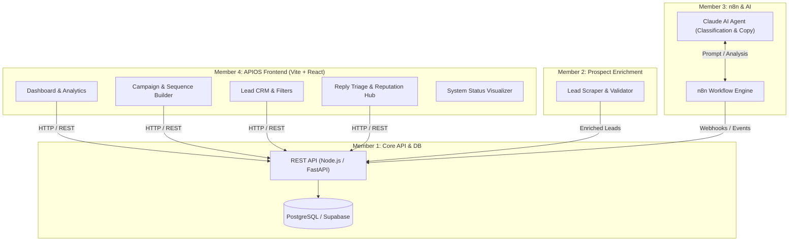

# APIOS — Automated Prospect Intelligence & Outreach System

[](https://react.dev/)
[](https://vitejs.dev/)
[]()
[]()

**APIOS** (*Automated Prospect Intelligence & Outreach System*) is an intelligent, high-deliverability cold outreach and prospect management command center. It unifies AI-driven lead enrichment, multi-step email sequences, automated reply classification, sender reputation monitoring, and real-time analytics into a single interface.

---

## 📑 Table of Contents

- [Overview](#-overview)
- [Key Features](#-key-features)
- [System Architecture & Team Scope](#-system-architecture--team-scope)
- [Tech Stack](#-tech-stack)
- [Project Structure](#-project-structure)
- [Getting Started](#-getting-started)
  - [Prerequisites](#prerequisites)
  - [Installation](#installation)
  - [Environment Variables](#environment-variables)
  - [Development Server](#development-server)
  - [Production Build](#production-build)
- [API Contract & Integration Guide](#-api-contract--integration-guide)
- [Security Best Practices](#-security-best-practices)
- [License](#-license)

---

## 🚀 Overview

This repository houses the **Outreach Command Center & Intelligence Frontend** (Member 4 module). It includes interactive mock state and zero external runtime dependencies, enabling full standalone testing and UI review prior to connecting with backend microservices, n8n orchestration workflows, and Claude AI agents.



---

## ✨ Key Features

### 1. 📊 Executive Dashboard & Real-Time Metrics
- **KPI Grid**: Track total prospects, delivered emails, open rate, reply rate, and bounce rate with period-over-period trend indicators.
- **Weekly Volume Chart**: Visual breakdown of delivered, opened, and replied messages.
- **Outreach Funnel**: Conversion tracking across delivered $\rightarrow$ opened $\rightarrow$ replied $\rightarrow$ converted stages.
- **Live Activity Feed**: Real-time event stream logging sequence progression, bounce prevention alerts, and replies.

### 2. 🎯 Campaign & Multi-Touch Sequence Builder
- **3-Step Campaign Modal**:
  - *Step 1*: Campaign naming, target ICP definition, and core value proposition.
  - *Step 2*: Multi-touch AI sequence design with custom delay days, subject lines, and body copy.
  - *Step 3*: Sending schedule, timezone selection, and daily throttle limits.
- **Campaign Controls**: Activate, pause, inspect lead counts, bounce tracking, and sender reputation scores.

### 3. 👥 Lead Management & CRM
- Search leads across name, company, email, and campaign tags.
- Filter by dynamic status: `Interested`, `Follow-up`, `Genuine Reply`, `Contacted`, `Out of Office`, `Not Interested`.
- Inline status updating with instant UI feedback and toast notifications.

### 4. 💬 Smart Reply Triage & Reputation Hub
- **AI Sentiment & Category Classification**: Incoming replies automatically categorized into *Genuine Lead*, *Out of Office*, or *Not Interested* with confidence scores.
- **One-Click Triage**: Mark replies as handled or convert to CRM leads.
- **Sender Domain Health**: Live health tracker monitoring SPF, DKIM, DMARC validation, warm-up metrics, and IP pool status.

### 5. ⏱️ Automated Follow-Up Queue
- Timeline schedule displaying scheduled follow-ups, trigger conditions, recipient metadata, and countdown status.

### 6. 📈 Deep Analytics & Insights
- Comprehensive performance charts, sender domain deliverability breakdowns, and audit event logs.

### 7. ⚡ System Status & Architecture Monitor
- Live health status indicators for Frontend, API Gateway, n8n Engine, Database, and Claude AI Workers.

### 8. 🎨 UI/UX Excellence
- Dual-theme system (**Dark Mode** & **Light Mode**) with system preference detection and `localStorage` persistence.
- Glassmorphism aesthetic, responsive navigation drawer for mobile/tablet, and custom micro-animations.

---

## 🛠️ Tech Stack

| Layer | Technology |
| :--- | :--- |
| **Framework** | [React 18](https://react.dev/) (Functional Components, Hooks) |
| **Build Tool** | [Vite 6](https://vitejs.dev/) |
| **Icons** | [React Icons](https://react-icons.github.io/react-icons/) (`hi`, `bs`, `ri`, `fi`, `vsc`) & [Lucide React](https://lucide.dev/) |
| **Styling** | Custom Vanilla CSS (Design Tokens, Glassmorphism, Theme Engine) |

---

## 📁 Project Structure

```text
APIOS-MAJOR-PROJECT/
├── index.html              # HTML entry point with Inter font & viewport meta
├── package.json            # Scripts and dependency declarations
├── package-lock.json       # Deterministic dependency tree lockfile
├── .env.example            # Sample environment variables
├── .gitignore              # Git ignore rules
├── README.md               # Project documentation
└── src/
    ├── main.jsx            # React root DOM mounting
    ├── App.jsx             # Main application component, routing, views & demo store
    └── styles.css          # Design tokens, theme variables, components & responsive layout
```

---

## 🚀 Getting Started

### Prerequisites
- **Node.js**: `v18.0.0` or higher (`v20+` recommended)
- **npm**: `v9.0.0` or higher (or `pnpm` / `yarn`)

### Installation

1. Clone the repository and navigate to the project directory:
   ```bash
   git clone <repository-url>
   cd APIOS-MAJOR-PROJECT
   ```

2. Install dependencies:
   ```bash
   npm install
   ```

### Environment Variables

Copy the sample environment file:

```bash
cp .env.example .env
```

Configured variables:

```env
# Member 1 API Gateway URL
VITE_API_BASE_URL=http://localhost:3000/api

# Member 3 n8n Webhook Endpoint (optional for direct trigger tests)
VITE_N8N_WEBHOOK_BASE_URL=http://localhost:5678/webhook
```

### Development Server

Launch the Vite local development server:

```bash
npm run dev
```

Open your browser at:
```text
http://localhost:5173
```

### Production Build

To build the project for production and test the generated bundle:

```bash
# Compile and optimize bundle into dist/
npm run build

# Preview production build locally
npm run preview
```

---

## 🔌 API Contract & Integration Guide

When transitioning from local mock state to live backend microservices (Member 1 API & Member 3 n8n pipelines), the frontend expects the following REST API endpoints:

### Campaigns
- `GET /api/campaigns` — Fetch list of all campaigns and aggregate metrics.
- `POST /api/campaigns` — Create a new campaign and multi-step sequence.
- `PATCH /api/campaigns/:id` — Update status (`Active`, `Paused`, `Draft`) or campaign metadata.

### Leads
- `GET /api/leads?status=&search=` — Retrieve paginated leads with optional search and filter parameters.
- `PATCH /api/leads/:id` — Update lead status, stage, or assignment.

### Replies & Sentiment
- `GET /api/replies` — Retrieve inbound email replies with AI sentiment and confidence rating.
- `PATCH /api/replies/:id/handled` — Mark a reply as acknowledged / processed.

### Follow-ups & Queue
- `GET /api/followups` — Get pending and upcoming automated follow-up jobs.

### Analytics & System
- `GET /api/analytics/overview` — Get high-level KPI metrics (opens, clicks, replies, deliverability).
- `GET /api/system/health` — Retrieve status and latency across backend microservices.

---

## 🔒 Security Best Practices

To safeguard infrastructure and email deliverability:

1. **Zero Client-Side Secrets**: Never embed SMTP credentials, Claude API keys, Supabase Service Role keys, or n8n master tokens in frontend source files or `VITE_*` variables.
2. **Backend Proxy Pattern**: All outbound email dispatch, AI completions, and database writes must route through the authenticated backend API gateway.
3. **Domain Protection**: Inbound webhooks should be verified via HMAC signatures.

---

## 📄 License

This project is part of the **APIOS** major project initiative. All rights reserved.
